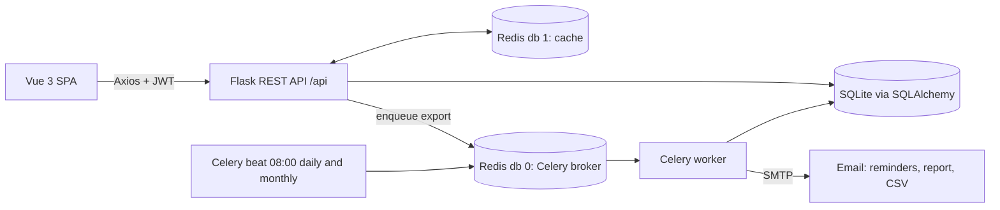

# Hospital Management System (MAD 2)

A single-page hospital management app built for the IITM BS *Modern Application Development 2* course: a **Flask REST API** with JWT login and a **Vue 3** front end, plus **Celery + Redis** background jobs for email reminders, a monthly report and CSV export.

**Links:** [GitHub](https://github.com/shriram-s7/HOSPITAL-MANAGEMENT-SYSTEM-MAD-2) · Earlier version: [MAD 1](https://github.com/shriram-s7/HOSPITAL-MANAGEMENT-SYSTEM-MAD-1) (Flask + server-rendered templates)

## Overview

MAD 1 was a server-rendered Flask app. MAD 2 rebuilds the same hospital workflow as a REST API with a Vue single-page front end and adds JWT authentication, Redis caching and scheduled/background jobs for reminders, monthly reports and CSV exports. It is a course project.

## What it does

Three roles, each with its own dashboard:

- **Admin**: dashboard totals; create, edit and delete departments, doctors and patients; view all appointments.
- **Doctor**: set availability; see assigned appointments; mark them completed or cancelled; add a treatment record (diagnosis, prescription, notes); view a patient's history.
- **Patient**: register and log in; edit profile; browse doctors; book and cancel appointments; request a CSV export of their treatment history.

Background jobs (Celery):

- `daily_reminders`: every day at 08:00, emails appointment reminders.
- `monthly_report`: on the 1st of each month at 08:00, emails an activity report.
- `export_csv_job`: builds and emails a patient's treatment-history CSV on request.

## How it works



## Stack

| Layer | Technology |
|---|---|
| API | Flask, Flask-SQLAlchemy, Flask-JWT-Extended, Flask-CORS, Flask-Caching |
| Database | SQLite (`backend/hms.db`, created on first run); `DATABASE_URL` can override |
| Cache / queue | Redis (broker and result backend on db 0, cache on db 1) |
| Jobs | Celery worker and Celery beat |
| Front end | Vue 3, Vue Router, Axios, Bootstrap 5, Vite |

## API overview

All routes are under `/api`; all except login and register need a JWT.

| Area | Routes |
|---|---|
| Auth | `POST /login`, `POST /register` |
| Admin | `GET /admin/dashboard`, `GET/POST /departments`, `GET/POST /admin/doctors`, `PUT/DELETE /admin/doctors/<id>`, `GET /admin/patients`, `PUT/DELETE /admin/patients/<id>`, `GET /admin/appointments` |
| Doctor | `GET /doctor/appointments`, `PUT /doctor/appointments/<id>/status`, `GET/POST /doctor/availability`, `POST /doctor/appointments/<id>/treatment`, `GET /doctor/patients/<id>/history` |
| Patient | `GET/PUT /patient/profile`, `GET /patient/doctors`, `GET/POST /patient/appointments`, `PUT /patient/appointments/<id>/cancel`, `POST /patient/export`, `GET /patient/export/download` |
| Job triggers | `POST /admin/test/daily-reminders`, `POST /admin/test/monthly-report` |

## Run it

Prerequisites: Python 3, Node.js, and a Redis server on `localhost:6379`.

```bash
# 1. Python environment (from the project root)
python -m venv venv
venv\Scripts\activate            # Windows
pip install flask flask-sqlalchemy flask-jwt-extended flask-cors flask-caching celery redis

# 2. Terminal 1: front end
cd frontend
npm install
npm run dev

# 3. Terminal 2: API (http://127.0.0.1:5000/api)
cd backend
python app.py

# 4. Terminal 3: Celery (optional, needs Redis)
cd backend
python -m celery -A celery_worker.celery worker --loglevel=info -P solo
python -m celery -A celery_worker.celery beat --loglevel=info      # scheduled jobs
```

`python backend/seed.py` loads sample departments and doctors. On first start the API creates an `admin` user (default password defined in `backend/app.py`; change it for any real use). `setup.txt` and `fix+setup.txt` hold the author's quick command notes.

## Configuration (environment variables)

See [`.env.example`](.env.example) for the names (placeholders only). The app reads real environment variables; it does not load a `.env` file by itself.


| Variable | Purpose |
|---|---|
| `SECRET_KEY`, `JWT_SECRET_KEY` | Flask and JWT signing keys (a development default is used if unset) |
| `DATABASE_URL` | Optional database URL instead of the bundled SQLite file |
| `HMS_SENDER_PASSWORD` | App password for the Gmail sender address used by the Celery email jobs. Without it, emails are not sent |

Never commit real keys or passwords; `.env` files are git-ignored.

## Layout

```
backend/    app.py, config.py, models.py (User, Department, DoctorProfile, PatientProfile, Appointment, Treatment),
            routes.py, seed.py, celery_worker.py
frontend/   Vue 3 + Vite app (src/views: Login, AdminDashboard, DoctorDashboard, PatientDashboard)
setup.txt, fix+setup.txt   original run notes
24f3004661 Project Report.pdf    course project report
```

## Usage

1. Start the API and front end (above), open the Vite URL, and log in as the admin created on first start.
2. Create departments and doctors (or run `python backend/seed.py`), then register a patient from the login page.
3. As the patient, book an appointment; as the doctor, complete it and add a treatment; as the patient, request the CSV export.
4. With Redis and Celery running, `POST /api/admin/test/daily-reminders` and `.../monthly-report` trigger the email jobs on demand.

## Tests

There is no automated test suite in this repository.

## Status and limitations

- Core flows for all three roles are implemented; the Celery email jobs need Redis and a Gmail app password to actually send mail, and were not exercised while writing this README.
- Uses the Flask development server, SQLite and development default secrets: not production-ready.
- The initial admin account has a default password defined in `backend/app.py`; change it before real use.
- Sender address and mail server are hard-coded in `celery_worker.py`.
- No front-end or back-end tests.

## Credits

Course project for IIT Madras BS, Modern Application Development 2, by S Shriram.

## License

No license specified.
